<div align="center">

<picture>
  <source media="(prefers-color-scheme: dark)" srcset=".github/assets/hero-dark.svg" />
  
</picture>

**TrenTorch Web: the browser version of TrenTorch. Hundreds of ML coding problems, graded instantly by Python running in your tab.**

[](https://github.com/TrenTorch/TrenTorch/actions/workflows/validate.yml)
[](https://trentorch.com)
[](#team-engineers)
[](https://svelte.dev/docs/kit)
[](LICENSE)

[Try it in the browser](https://trentorch.com) · [Features](#features) · [Run it locally](#run-it-locally) · [Anatomy of a question](#anatomy-of-a-question) · [Project layout](#project-layout) · [Contributing](#contributing) · [FAQ](#faq)

<table>
  <tr>
    <td align="center" width="150"><b>1328</b><br /><sub>module questions</sub></td>
    <td align="center" width="150"><b>251</b><br /><sub>problemset problems</sub></td>
    <td align="center" width="150"><b>454</b><br /><sub>DSA sheet questions</sub></td>
    <td align="center" width="150"><b>120</b><br /><sub>research papers</sub></td>
    <td align="center" width="150"><b>0</b><br /><sub>servers to run your code</sub></td>
  </tr>
</table>

<p>
  <picture><source media="(prefers-color-scheme: dark)" srcset=".github/assets/screens/dark-page-questions.png" />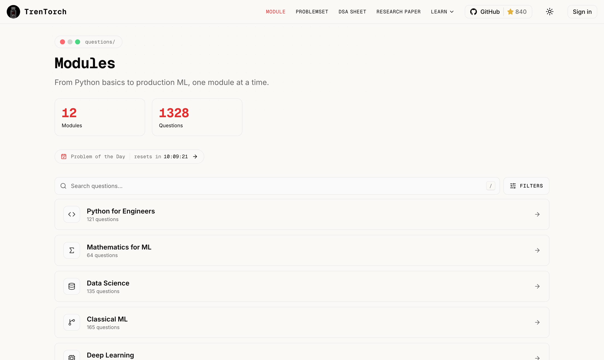</picture>
  <picture><source media="(prefers-color-scheme: dark)" srcset=".github/assets/screens/dark-ide-python.png" />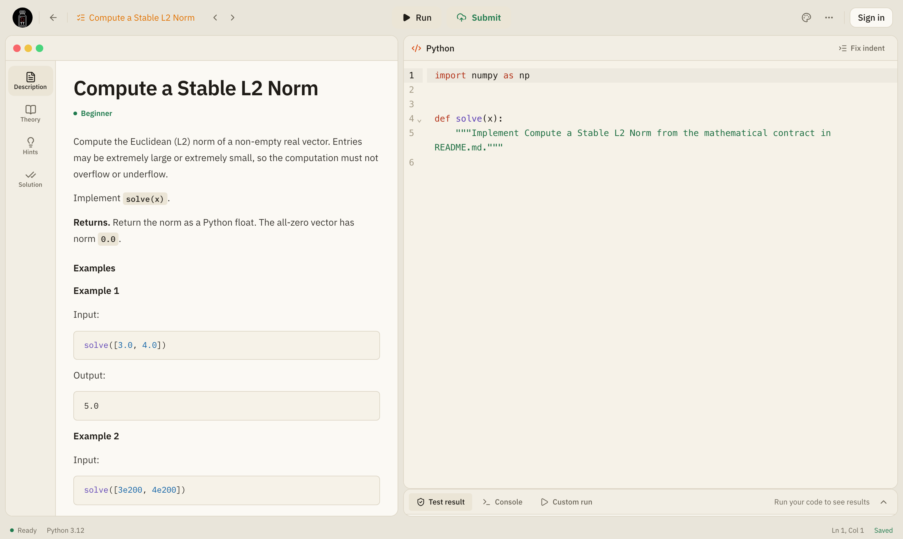</picture>
</p>

</div>

---

> [!NOTE]
> This is the **web-only branch** of [TrenTorch](https://github.com/TrenTorch/TrenTorch). Changes to the browser app land here first, kept apart from the CLI work so they can be mirrored onto the production site cleanly. The main branch is `TrenTorch-Dev`, and the web app also lives there under [`TrenTorch_Web/`](TrenTorch_Web).

## What it is

The same learn-by-building idea as the TrenTorch CLI, with nothing to install. Pick a problem, write the Python in the in-browser editor, and the tests run instantly in your tab. Python runs through Pyodide (WebAssembly), so grading never waits on a server, and your solved-question progress is saved to your account.

<table>
  <tr>
    <td valign="top" width="33%"><b>1. Pick a problem</b><br /><sub>Each one has a problem statement, a theory section and a starter file.</sub></td>
    <td valign="top" width="33%"><b>2. Write the code</b><br /><sub>The editor runs Python 3.12 in your browser with NumPy available.</sub></td>
    <td valign="top" width="33%"><b>3. Get graded</b><br /><sub>Real pytest-style tests run on the spot, and a reference solution is there once you want to compare.</sub></td>
  </tr>
</table>

## Features

### Modules

12 modules and 1328 questions, from Python for Engineers through Deep Learning, LLMs, RL, Computer Vision, Agentic systems, Distributed systems and Production reliability. Everything is searchable and filterable, and your progress is saved per module.


### Problemset

251 problems across 5 modules. The **FilterBar** narrows the list by module, difficulty, status, topic and company, and has dedicated toggles for Company Case Studies and past Problem of the Day questions.

<table>
  <tr>
    <td width="50%" align="center"><picture><source media="(prefers-color-scheme: dark)" srcset=".github/assets/screens/dark-filters-closed.png" />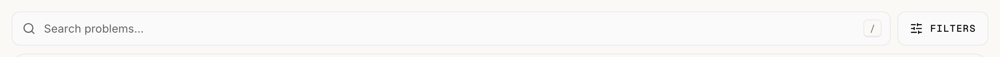</picture></td>
    <td width="50%" align="center"><picture><source media="(prefers-color-scheme: dark)" srcset=".github/assets/screens/dark-filters-open.png" />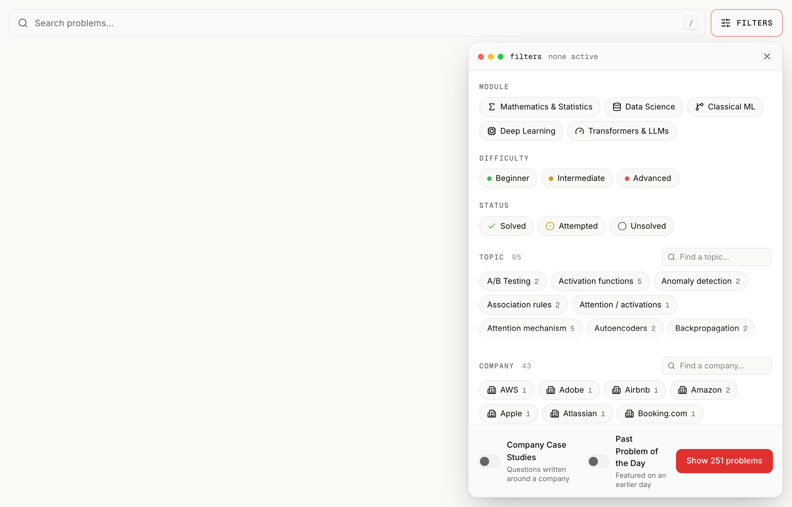</picture></td>
  </tr>
</table>

<picture><source media="(prefers-color-scheme: dark)" srcset=".github/assets/screens/dark-modules.png" />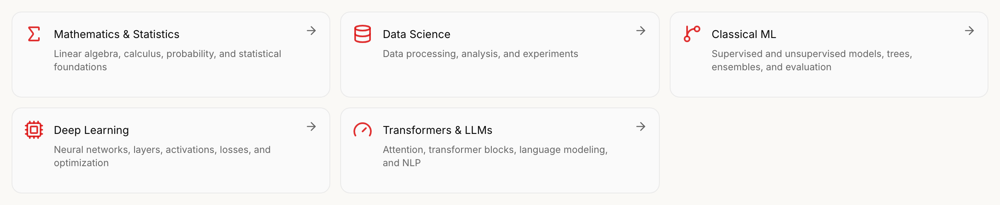</picture>

<picture><source media="(prefers-color-scheme: dark)" srcset=".github/assets/screens/dark-rows.png" />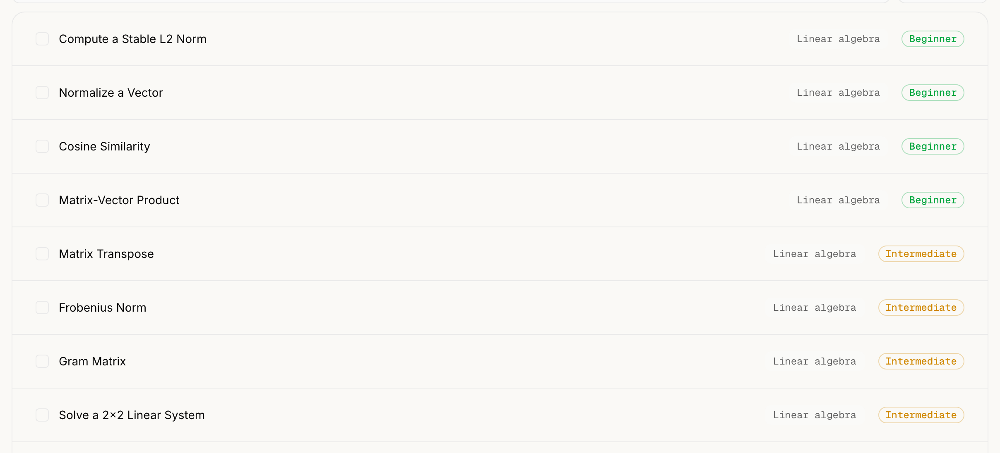</picture>

### Problem of the Day

One problem a day, the same for everyone. It rolls over at **00:00 IST**, with a live countdown, and every past problem stays in the archive.

<table>
  <tr>
    <td width="50%" align="center"><picture><source media="(prefers-color-scheme: dark)" srcset=".github/assets/screens/dark-potd-pill.png" />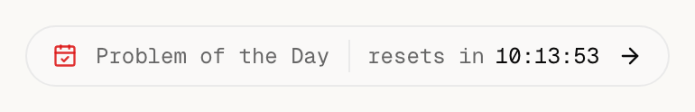</picture></td>
    <td width="50%" align="center"><picture><source media="(prefers-color-scheme: dark)" srcset=".github/assets/screens/dark-potd-page.png" />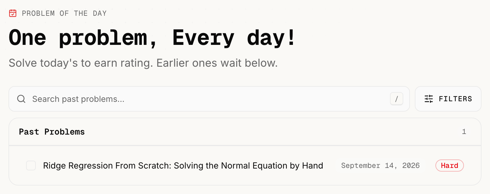</picture></td>
  </tr>
</table>

### DSA Sheet

454 questions in 21 progressions, from complexity basics up to the summit problems. Solve each one in **Python, JavaScript, C++, Java, Go or Rust**, run in your browser with no server.

<picture><source media="(prefers-color-scheme: dark)" srcset=".github/assets/screens/dark-dsa-stats.png" />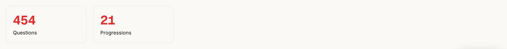</picture>

<picture><source media="(prefers-color-scheme: dark)" srcset=".github/assets/screens/dark-dsa-filters.png" />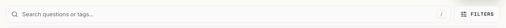</picture>

<table>
  <tr>
    <td width="50%" align="center"><picture><source media="(prefers-color-scheme: dark)" srcset=".github/assets/screens/dark-dsa-step.png" />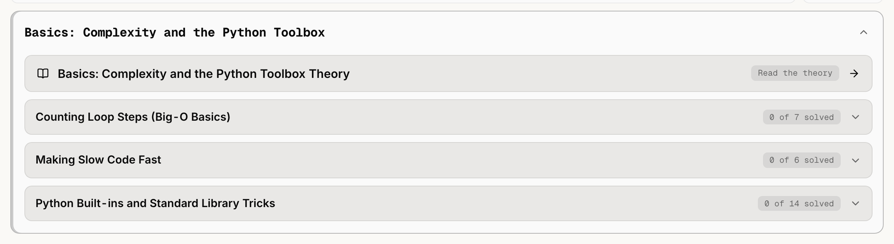</picture></td>
    <td width="50%" align="center"><picture><source media="(prefers-color-scheme: dark)" srcset=".github/assets/screens/dark-dsa-summit.png" />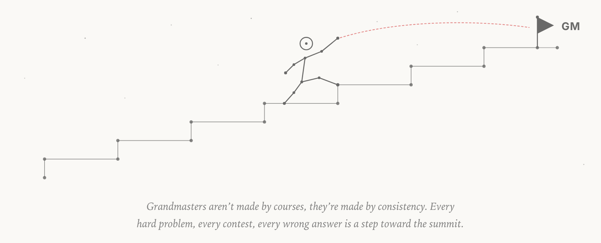</picture></td>
  </tr>
</table>

<picture><source media="(prefers-color-scheme: dark)" srcset=".github/assets/screens/dark-ide-dsa.png" />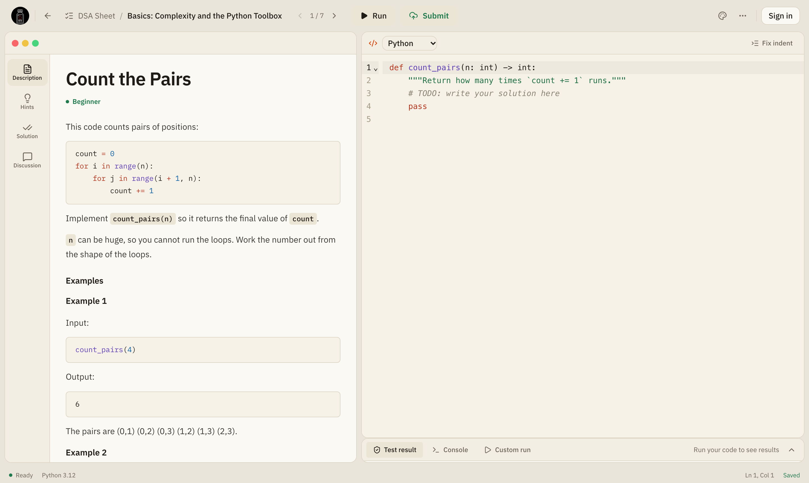</picture>

### Research Papers

10 tracks, 120 papers and 360 implementations. Read the paper, then implement its core idea yourself.

<picture><source media="(prefers-color-scheme: dark)" srcset=".github/assets/screens/dark-papers-stats.png" />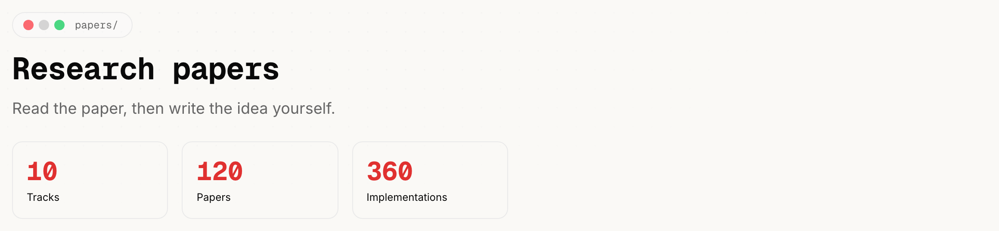</picture>

<picture><source media="(prefers-color-scheme: dark)" srcset=".github/assets/screens/dark-papers-tracks.png" />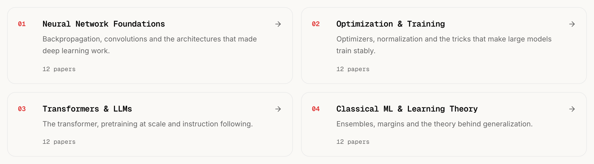</picture>

### In-browser IDE

Python 3.12 via Pyodide (WebAssembly) with NumPy, graded instantly. Every question has a statement, hints, a reference solution and a discussion thread.


## Run it locally

```bash
cd TrenTorch_Web
npm install
cp .env.example .env   # add your own Supabase URL and anon key to enable sign-in
npm run dev -- --open
```

The Supabase keys are only needed for sign-in and saved progress. The anon key is public-safe by design, since access control lives in row-level security policies.

| Command | What it does |
|---|---|
| `npm run check` | Type check (svelte-check) |
| `npm run lint` | Prettier and ESLint |
| `npm run test` | Unit tests (Vitest) |
| `npm run test:smoke` | Fast smoke project only |
| `npm run test:pyodide` | Runs every question's reference solution and tests in a real Pyodide |
| `npm run test:content` | Runs each question's `tests.py` against its `solution.py` with pytest |
| `npm run curriculum:build` | Compiles the curriculum source into the app's bundle |
| `npm run build` | Production build |

Run `check`, `lint`, `test` and `build` before you push. CI runs the same checks on every pull request.

## Anatomy of a question

Questions are plain files under [`TrenTorch_Web/data/app_data/`](TrenTorch_Web/data/app_data), nested as section, then sub-section, then track, then question. The build step compiles them into the app, so there is no generated content to commit.

```text
01-supervised-models/            a sub-section
└── 01-linear-regression/        a track
    └── 02-mse-loss/             one question
        ├── README.md            frontmatter (name, tags, difficulty) + Statement / Theory / Explanation
        ├── starter.py           what the student sees first: real signature, TODO body
        ├── solution.py          the reference solution, real runnable Python
        └── tests.py             real pytest file, runnable directly
```

DSA sheet questions are language-neutral: they carry a `problem.json` and per-language starters instead of a Python `tests.py`.

The full conventions are in the [authoring guide](TrenTorch_Web/data/app_data/README.md).

## Project layout

```text
TrenTorch_Web/
├── platform/                  # Routes, components, widgets, fonts, static assets
│   └── routes/                    # questions, problemset, ide, potd, papers, account, ...
├── processes/                 # Logic behind the screens
│   ├── code-execution/            # Pyodide worker and the run/grade pipeline
│   ├── curriculum-build/          # Compiles app_data into the in-app bundle
│   ├── potd/                      # Problem of the Day (IST rollover)
│   ├── auth/, progress-tracking/  # Sign-in and saved progress
│   └── ide-content/, markdown/, problemset/, papers/, rating/, discussion/, profile/, seo/
├── data/                      # Curriculum (app_data/), question and POTD loaders
├── pyodide-check/             # Runs every question in Pyodide as a repo check
├── e2e/                       # End-to-end and build-output checks
├── supabase/migrations/       # Auth and user-data schema, with RLS policies
└── docs/                      # Design specs and plans
```

Built with SvelteKit 2, Svelte 5, TypeScript, Tailwind CSS 4, Vite and Vitest, with Supabase for auth and Pyodide for running code. Deployed on Vercel.

## Contributing

Issues and pull requests are welcome. Start with the [contributing guide](TrenTorch_CLI/docs/CONTRIBUTING.md): open an issue first, and ask to be assigned before you start on it. CI has to be green and one review from someone other than the author is required to merge.

Pull requests for the web app should target `TrenTorch-Web-Dev`. Found a security problem? Do not open a public issue. Read [SECURITY.md](SECURITY.md).

---

## Team Engineers

<div align="center">

<table>
  <tbody>
    <tr>
      <td align="center" valign="top" width="50.0%">
        <a href="https://github.com/Shashank-Tripathi-07"></a>
        <br />
        <sub><strong>Principal Maintainer &amp; Infrastructure Architect</strong></sub>
        <br />
        <sub>IIT Guwahati<br />Debugs autograd for fun, ships before sunrise</sub>
        <br />
        &nbsp;
      </td>
      <td align="center" valign="top" width="50.0%">
        <a href="https://github.com/ShivtejG236"></a>
        <br />
        <sub><strong>Maintainer &amp; Head of EngOps</strong></sub>
        <br />
        <sub>IIT Guwahati<br />Shows up, builds systems, moves on to the next thing</sub>
        <br />
        &nbsp;
      </td>
    </tr>
  </tbody>
  <tbody>
    <tr>
      <td align="center" valign="top" width="50.0%">
        <a href="https://github.com/maanas1234"></a>
        <br />
        <sub><strong>Maintainer &amp; Core Engineer</strong></sub>
        <br />
        <sub>Catches bugs, builds solutions &amp; ships fast</sub>
        <br />
        &nbsp;
      </td>
      <td align="center" valign="top" width="50.0%">
        <a href="https://github.com/aadityansha06"></a>
        <br />
        <sub><strong>Maintainer &amp; Growth Lead</strong></sub>
        <br />
        <sub>Processor engineer, breathes Assembly &amp; CUDA</sub>
        <br />
        &nbsp;
      </td>
    </tr>
  </tbody>
</table>

</div>

---

## License

[PolyForm Noncommercial License 1.0.0](LICENSE): free for personal, educational, and noncommercial use. Not licensed for commercial use.

## Code of Conduct

This project follows the [Contributor Covenant](CODE_OF_CONDUCT.md). It applies in issues, pull requests, discussions, and on [trentorch.com](https://trentorch.com).

## FAQ

<details>
<summary>Where does my code run?</summary>

In your browser, using Pyodide (Python compiled to WebAssembly). Running and grading a question does not need a server. Your progress is saved to your account, which you create by signing in with GitHub, Google, or an email link.

</details>

<details>
<summary>Do I need a GPU, PyTorch, or TensorFlow?</summary>

No. Everything runs on the CPU with NumPy, and the curriculum never imports PyTorch or TensorFlow.

</details>

<details>
<summary>How do I add or fix a question?</summary>

Open an issue first and ask to be assigned. Then follow the [authoring guide](TrenTorch_Web/data/app_data/README.md): a question is a folder with a `README.md`, `starter.py`, `solution.py` and `tests.py`. `npm run test:content` confirms the solution passes its own tests before it reaches the app.

</details>

<details>
<summary>What is the difference between this branch and TrenTorch-Dev?</summary>

`TrenTorch-Dev` is the main branch and carries everything, including the CLI. `TrenTorch-Web-Dev` carries only web changes, so they stay easy to mirror onto the production site.

</details>

<details>
<summary>I found a bug. Where do I report it?</summary>

Open a [GitHub issue](https://github.com/TrenTorch/TrenTorch/issues) with steps to reproduce. For a security problem, do not open a public issue: follow [SECURITY.md](SECURITY.md).

</details>

---

<div align="center">

<b>Build it yourself. Understand it fully.</b>

</div>
